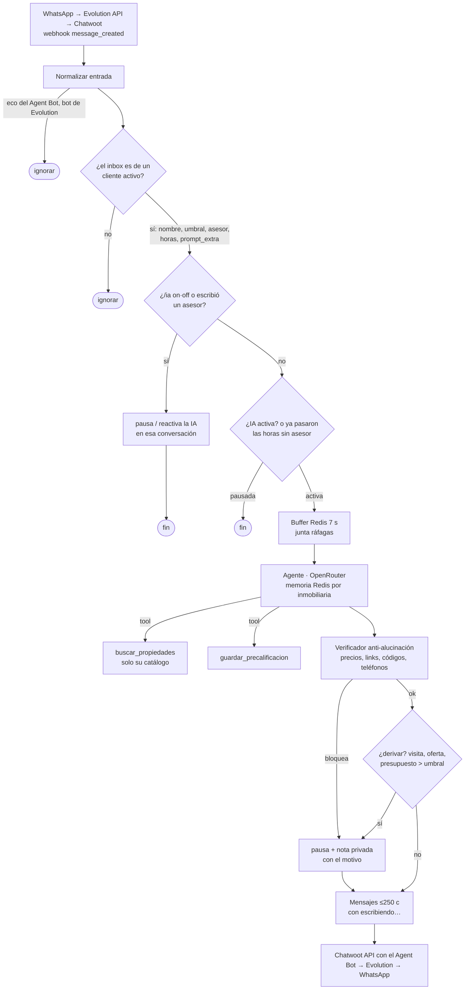

# Recepcionista IA para inmobiliarias

**Atiende el WhatsApp de la inmobiliaria las 24 horas con su catálogo real, precalifica a cada
interesado y le pasa la conversación a un asesor cuando hace falta. No inventa precios.**

Una sola instalación atiende a varias inmobiliarias. Cada una tiene su número, su catálogo, sus
asesores y su tono. El equipo trabaja desde la app de Chatwoot en el celular.

## Qué resuelve

| Problema de la inmobiliaria | Qué hace el recepcionista |
|---|---|
| Consultas de noche, en fin de semana o mientras el asesor está en una visita | Responde al instante con propiedades **reales** de su planilla: código, precio y link a la ficha |
| Un bot que inventa un precio es un problema legal y comercial | Un **verificador** revisa cada respuesta y bloquea cualquier precio, link, código o teléfono que no salga del catálogo |
| Leads sin calificar | Pregunta de a poco operación, zona, presupuesto, ambientes, forma de pago y urgencia, y lo guarda |
| Saber cuándo tiene que entrar una persona | Deriva sola si piden visita, oferta o reserva, si el presupuesto supera el umbral o si no pudo confirmar un dato, y deja una **nota privada con el motivo** |
| Que el bot no se meta cuando el asesor ya tomó la charla | En cuanto escribe un asesor, el bot **se calla solo** en esa conversación. Vuelve con `/ia on` o solo, a las X horas sin mensajes del asesor |

## Cómo se ve

1. El cliente escribe *"Busco un depto en venta en el Centro hasta 200 mil dólares"*.
2. A los segundos recibe 2 o 3 propiedades reales, con código, precio y link.
3. Pregunta por un barrio que no está en el catálogo: el bot no inventa. Le dice que lo confirma un
   asesor y le deja la nota al equipo en Chatwoot.
4. El asesor contesta desde la app y el bot ya no interviene.

Para mostrarlo: `npm run demo` y el guion de 60 segundos en **[docs/GUION-VIDEO.md](docs/GUION-VIDEO.md)**.

## Cómo se instala

Necesitás Docker, Node.js 20 o más nuevo, una PC o VPS con 8 GB de RAM y una API key de OpenRouter.

```bash
npm install
npm run instalar                                   # stack completo, base, webhook, Agent Bot y flujo de n8n
npm run nuevo-cliente -- "Inmobiliaria del Lago"   # WhatsApp + inbox + cliente, y muestra el QR
npm run importar -- planilla.csv --cliente 1       # catálogo de esa inmobiliaria
```

Lo único manual:
- crear tu usuario de Chatwoot;
- pegar 2 tokens en `.env` (Chatwoot y OpenRouter);
- escanear el QR de cada inmobiliaria.

Los scripts son idempotentes y te avisan cuándo te toca a vos.

| Guía | Para qué |
|---|---|
| [docs/PUESTA-EN-MARCHA.md](docs/PUESTA-EN-MARCHA.md) | Instalación local, alta de clientes, catálogo, túnel y cómo se opera |
| [docs/DEPLOY.md](docs/DEPLOY.md) | VPS con Dokploy, DNS en Cloudflare (`chat.`, `n8n.`, `evo.`), HTTPS, backups diarios y cómo actualizar |
| [docs/ALTA-CLIENTE.md](docs/ALTA-CLIENTE.md) | Checklist para sumar una inmobiliaria en menos de 30 minutos |

## Cómo se opera: desde la app de Chatwoot

| El asesor quiere… | Hace… |
|---|---|
| Atender él una conversación | **Escribe y listo**: el bot se pausa solo |
| Devolvérsela al bot | Nota privada `/ia on`. Si no la manda, el bot vuelve solo a las X horas (12 por defecto) |
| Pausar el bot sin escribirle al cliente | Nota privada `/ia off` |
| Saber por qué el bot le pasó una charla | La nota privada 🤖 con el motivo: visita, oferta, presupuesto alto o un dato que no pudo confirmar |

Y vos, como operador:

| Comando | Qué hace |
|---|---|
| `npm run clientes` | Estado de todas las inmobiliarias: WhatsApp, propiedades, leads y si están activas |
| `npm run nuevo-cliente -- "Nombre" --asesor … --umbral … --horas … --prompt-archivo …` | Alta o cambio de una inmobiliaria (y QR) |
| `npm run importar -- planilla.csv --cliente <id> --desactivar-faltantes` | Actualiza el catálogo; valida todo antes de escribir |
| `npm run clientes -- --desactivar <id>` | El bot deja de atender a esa inmobiliaria, sin perder datos |
| `npm run backup` | Backup de Postgres; en el VPS corre todos los días por cron |
| `npm run demo` | Reinicia "Inmobiliaria Demo" para mostrarla |

## Cómo funciona



| Pieza | Rol |
|---|---|
| **Evolution API v2** | Conecta el número de WhatsApp de cada inmobiliaria (QR) y crea su inbox en Chatwoot |
| **Chatwoot** | Inbox del equipo, app del celular, notas privadas. El bot escribe con su propio **Agent Bot** (`sender.type = agent_bot`), y así se distingue de los asesores (`user`) |
| **n8n 2.x** | Un solo flujo para todas las inmobiliarias. Identifica a cada una por el inbox (tabla `clientes`) |
| **Postgres** (pgvector) | Bases separadas para `inmo` (clientes, propiedades, leads y eventos), `chatwoot`, `n8n` y `evolution` |
| **Redis** | Buffer de ráfagas y memoria de la conversación, separados por inmobiliaria |
| **OpenRouter** | El modelo; se cambia en el nodo *OpenRouter Model*. El verificador funciona igual con cualquiera |

Todo el stack es propio y corre con `docker compose`, con healthchecks y volúmenes. Usa ~1,6 GB de RAM
en reposo: entra en una PC de 8 GB y en un VPS de 4–8 GB.

## Probado de punta a punta

`npm run test:e2e` levanta n8n 2.46 real, contra Postgres y Redis reales, con un **LLM falso
determinístico** y un **Chatwoot falso** que registra lo que se envía. Los mensajes entran con el
formato real del webhook de Chatwoot, con los tipos de remitente verificados contra Chatwoot 4.19.
Así se prueba el flujo, no la suerte del modelo: **40 chequeos**.

| Escenario | Qué verifica |
|---|---|
| Consulta | muestra solo propiedades del catálogo y guarda la precalificación |
| Ráfaga | dos mensajes seguidos → el agente corre una vez y recibe los dos |
| Precio inventado / alterado | el verificador bloquea "USD 150.000" sin respaldo y "USD 25.000" cuando el catálogo dice 125.000 |
| Derivación | por visita y por presupuesto mayor al umbral: pausa y nota privada con el motivo |
| Pausa humana | `/ia off` silencia (ni llama al modelo) y `/ia on` reactiva |
| Pausa automática | un mensaje público de un asesor pausa la IA |
| Reactivación automática | a las 11 h sigue en pausa; a las 13 h (umbral de 12 h) responde de nuevo |
| Eco y bot de Evolution | ignora los mensajes del propio Agent Bot y la conversación del QR de Evolution |
| Multi-cliente | cada inmobiliaria ve solo su catálogo, con su umbral y su `prompt_extra` |
| Mismo WhatsApp, dos inmobiliarias | dos leads separados, y la memoria no pasa de una a otra |
| Inbox sin cliente | un inbox sin cliente, o con el cliente inactivo, se ignora |
| Demo | el seed se carga en un cliente sin duplicar ni tocar a otros |
| Autenticación | todas las llamadas a Chatwoot llevan `api_access_token` |

```bash
docker compose -f docker-compose.test.yml up -d
N8N_BIN=./test/e2e/n8n-docker.sh npm run test:e2e   # n8n desde su imagen oficial (Linux); o N8N_BIN=/ruta/a/n8n
```

Para probar el webhook a mano, sin WhatsApp: `workflows/payloads-de-prueba.md`.

## Datos

- `data/schema.sql` + `data/migraciones/`: tablas `clientes`, `propiedades`, `leads` y `eventos_equipo`.
  Las migraciones son idempotentes y no borran datos.
- `data/plantilla-propiedades.csv`: la planilla que completa cada inmobiliaria.
- `data/seed_propiedades.sql`: 20 propiedades **sintéticas** de Bariloche para la demo. Los datos del
  repo son inventados: propiedades, precios y teléfonos.

Detalle funcional en [SPEC.md](SPEC.md). Licencia MIT.
